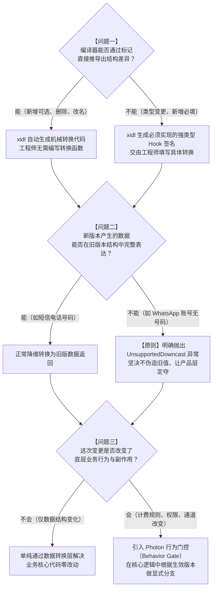
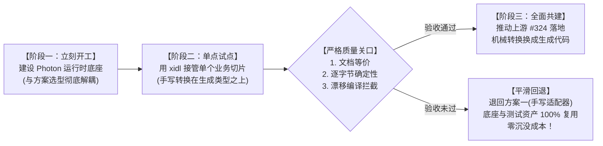

# Photon 接口版本管理完整调研：从第一性原理到工程落地

> 本文档基于 2026-10-14 评审事实，综合《Photon API版本化治理与映射层调研》《XIDL × Photon Versioned API 深度审计》《Cadwyn、XIDL 对比与最小可落地方案》三份前期调研成果，严格按照演示文稿（`SlidevPresentation/decks/2026-10-photon-versioned-api/slides.md`）的逻辑展开。
> 全文剥离行业黑话与空泛修辞，以第一性原理和奥卡姆剃刀为准绳，面向广泛技术受众，全面讲透 API 版本管理的本质、行业标杆实践、三种实现方案（手写转换、Cadwyn、xidl）的代码级运作与维护成本，并给出确定性的落地与回退路线。

---

## 术语速查表

为了让初次接触该领域的读者阅读无障碍，本文涉及的所有缩写和专业名词在此提供统一释义：

| 词汇 | 全称 / 原词 | 通俗释义 |
| :--- | :--- | :--- |
| **API** | Application Programming Interface | **应用程序接口**。外部客户或内部其他程序调用我们服务的统一入口（例如：`POST /v1/messages` 发送消息）。 |
| **接口版本** | API Version | 接口在特定历史时间点的结构形态。客户一旦锁定该版本，其交互的数据格式就保持固定不变。 |
| **最新版（Head）** | Head / Preview | 代码库中唯一正在维护和运行的最新业务逻辑与数据模型。业务开发永远只面向它写代码。 |
| **升级转换（Upcast）** | Request Upcasting | **入站升维转换**。把旧版本客户提交上来的请求数据，翻译补齐为最新版业务逻辑所要求的结构。 |
| **降维转换（Downcast）** | Response / Event Downcasting | **出站降维转换**。把最新版业务代码产出的结果或事件，裁剪翻译回客户所锁定的历史旧版本结构。 |
| **Webhook** | Webhook | **反向网络推送**。当系统内部发生某件事情时，由我们的服务器主动向客户配置的网址发送 HTTP 请求，失败时会自动重试。 |
| **SDK** | Software Development Kit | **软件开发工具包**。由平台官方打包发布的跨语言代码库（如 TypeScript、Python、Rust、Go），供客户直接在代码中调用 API。 |
| **OpenAPI** | OpenAPI Specification | 描述 HTTP 接口的通用国际标准文档格式（通常是一个 `openapi.json` 文件），API 接口文档与多语言 SDK 均由此自动生成。 |
| **IDL** | Interface Definition Language | **接口定义语言**。用专门的中立文本语法来定义数据结构和接口，再由专用编译器生成各语言的代码和文档（例如 xidl）。 |
| **HIR** | High-level Intermediate Representation | **高级中间表示**。编译器在把 IDL 翻译成各种编程语言之前，在内存中构建的一套类型完备、剥离了具体语言语法的纯粹语法树。 |
| **AST** | Abstract Syntax Tree | **抽象语法树**。程序源代码在计算机语法层面的树状结构表示。 |
| **幂等（Idempotency）** | Idempotency | 无论同一个操作因网络超时被重复提交了多少次，系统内部有且仅执行一次实际业务，绝不产生重复扣费或重复发信等副作用。 |
| **行为门控** | Behavior Gate / Feature Gate | **行为开关**。用于处理无法通过数据结构字段翻译来抹平的深层业务逻辑差异（如扣费规则、权限体系、发送通道改变）。 |

---

## 目录

- [Photon 接口版本管理完整调研：从第一性原理到工程落地](#photon-接口版本管理完整调研从第一性原理到工程落地)
  - [术语速查表](#术语速查表)
  - [目录](#目录)
  - [一、行业怎么做：Stripe 与 Polar 的实践与取舍](#一行业怎么做stripe-与-polar-的实践与取舍)
    - [1.1 Stripe 的做法：客户体验与“时间倒流”内部实现](#11-stripe-的做法客户体验与时间倒流内部实现)
      - [外部客户如何使用版本](#外部客户如何使用版本)
      - [内部工程如何实现：跟着一个事件“倒走时光”](#内部工程如何实现跟着一个事件倒走时光)
        - [第一部分：一张全局变更总表（登记哪个日期发生了哪些变化）](#第一部分一张全局变更总表登记哪个日期发生了哪些变化)
        - [第二部分：极简且独立的单次变更模块](#第二部分极简且独立的单次变更模块)
    - [1.2 Polar 的做法：客户体验与“标记有效期”内部实现](#12-polar-的做法客户体验与标记有效期内部实现)
      - [外部客户如何使用版本](#外部客户如何使用版本-1)
      - [内部工程如何实现：在字段和路由上标“有效期”](#内部工程如何实现在字段和路由上标有效期)
    - [1.3 两家对比与本质取舍](#13-两家对比与本质取舍)
      - [两种模式背后的架构取舍真相](#两种模式背后的架构取舍真相)
  - [二、第一性原理推导：版本管理的本质到底是什么](#二第一性原理推导版本管理的本质到底是什么)
    - [2.1 剥离黑话：三个不可简化的基本事实（公理）](#21-剥离黑话三个不可简化的基本事实公理)
      - [公理一（内部演进零阻力）](#公理一内部演进零阻力)
      - [公理二（外部消费确定性）](#公理二外部消费确定性)
      - [公理三（中间层本质上只是纯函数翻译器）](#公理三中间层本质上只是纯函数翻译器)
    - [2.2 奥卡姆剃刀：我们要什么，坚决不要什么](#22-奥卡姆剃刀我们要什么坚决不要什么)
    - [2.3 典型场景剖析：旧版请求在系统内的完整流转](#23-典型场景剖析旧版请求在系统内的完整流转)
      - [业务改动背景](#业务改动背景)
      - [关键设计原则：不可表示时，必须明确报错！](#关键设计原则不可表示时必须明确报错)
      - [完整的 7 步流转过程](#完整的-7-步流转过程)
    - [2.4 无论哪种方案，Photon 运行时都必须自建的底座](#24-无论哪种方案photon-运行时都必须自建的底座)
  - [三、Photon 的三条实现路线详细剖析](#三photon-的三条实现路线详细剖析)
    - [3.1 方案一：纯手写转换适配器（TypeScript）](#31-方案一纯手写转换适配器typescript)
      - [实际运作方式](#实际运作方式)
      - [完整代码实现示例](#完整代码实现示例)
      - [改动一次接口，需要人工维护 6 处地方](#改动一次接口需要人工维护-6-处地方)
      - [优缺点与维护性评估](#优缺点与维护性评估)
    - [3.2 方案二：引入 Cadwyn 框架（Python）](#32-方案二引入-cadwyn-框架python)
      - [实际运作方式](#实际运作方式-1)
      - [完整代码实现示例](#完整代码实现示例-1)
      - [实测效果验证](#实测效果验证)
      - [为什么 Cadwyn“思路很好，但装不进 Photon 系统”？](#为什么-cadwyn思路很好但装不进-photon-系统)
      - [优缺点与维护性评估](#优缺点与维护性评估-1)
    - [3.3 方案三：引入 xidl 契约编译器（推荐目标）](#33-方案三引入-xidl-契约编译器推荐目标)
      - [实际运作方式](#实际运作方式-2)
      - [IDL 定义文件示例](#idl-定义文件示例)
      - [编译器做了什么：像出版社印书一样按版裁剪](#编译器做了什么像出版社印书一样按版裁剪)
      - [实际编译生成的结果对照](#实际编译生成的结果对照)
      - [威力展现：类型漂移在编译期被当场抓获（实测 TS2741）](#威力展现类型漂移在编译期被当场抓获实测-ts2741)
      - [转换代码的分工：xidl 能生成多少，Photon 开发者写什么？](#转换代码的分工xidl-能生成多少photon-开发者写什么)
      - [优缺点与维护性评估](#优缺点与维护性评估-2)
    - [3.4 架构演进中每次修改接口的“灵魂三问”决策树](#34-架构演进中每次修改接口的灵魂三问决策树)
  - [四、方案决策与落地路线](#四方案决策与落地路线)
    - [4.1 三种方案能力全景对比矩阵](#41-三种方案能力全景对比矩阵)
    - [4.2 长期演进成本推演：当系统演进到第 5 个版本时](#42-长期演进成本推演当系统演进到第-5-个版本时)
    - [4.3 推荐分阶段落地路线与质量关口](#43-推荐分阶段落地路线与质量关口)
      - [阶段一：立刻开始，建设无论如何都要自建的运行时底座（当前即可开工）](#阶段一立刻开始建设无论如何都要自建的运行时底座当前即可开工)
      - [阶段二：选定垂直切片，引入 xidl 进行深度试点](#阶段二选定垂直切片引入-xidl-进行深度试点)
      - [阶段三：设立严格关口验收，并与上游共建推进](#阶段三设立严格关口验收并与上游共建推进)
    - [4.4 风险防范与安全退路](#44-风险防范与安全退路)

---

## 一、行业怎么做：Stripe 与 Polar 的实践与取舍

在 API 版本管理领域，全球公认做得最深、最成体系的是 **Stripe**（支付基础设施标杆），而近两年以现代轻量级范式崭露头角的是 **Polar**（新型开发者计费与赞助平台）。两家解决的是同一个根本矛盾：**外部客户希望对接一次就永远不坏，内部工程师希望天天发布新功能。**

但它们给出的解法大相径庭，正好代表了两种截然不同的工程哲学。

---

### 1.1 Stripe 的做法：客户体验与“时间倒流”内部实现

#### 外部客户如何使用版本
1. **版本号格式**：采用“日期 + 名字”，例如 `2026-09-30.endive`。
2. **如何指定版本**：通过自定义 HTTP 请求头 `Stripe-Version` 指定。
3. **未指定时的默认行为**：**在客户账户第一次发起 API 调用时，Stripe 会自动将当天的最新版本记为该账户的永久默认版本**。之后除非客户在控制台手动点击升级，否则其默认版本永远保持不变。
4. **版本发布节奏**：每月发布一次，但严格约定**不包含破坏性改动（Breaking Changes）**；每年仅发布两次带有代号的大版本（如 Acacia、Basil、Endive），所有破坏性改动必须集中在这两次大版本中释放。
5. **Webhook 推送策略**：每个 Webhook 接收地址在创建时都**硬绑定一个明确的版本号**。系统主动向该地址推送数据时，无论当前代码迭代到什么阶段，推送体都必须符合该地址锁定的版本格式。如果客户要升级版本，官方指导是新建一个接收地址并切流。
6. **SDK 策略**：每个 SDK 发布版本固定绑定其发布当天的 API 接口版本，客户只需锁定 SDK 版本，就能天然锁定接口交互格式。

#### 内部工程如何实现：跟着一个事件“倒走时光”
Stripe 内部支撑了数百次破坏性升级，但业务核心层**从来不为每个版本写一套代码**。

业务逻辑和数据库交互产出的数据，永远只有一套唯一的最新结构（Head）。当需要将数据返回给一个锁在旧版本的客户时，Stripe 使用一套被称为 **“时间倒流（Walking Back Through Time）”** 的管道，将数据一层一层倒推回旧格式。

```text
【最新业务代码】产出最新格式事件
      │
      ▼
┌────────────────────────────────────────────────────────┐
│ 套用 2017-05-25 的改动模块（CollapseEventRequest）       │
│ 将 request 从对象 {id, idempotency_key} 倒退回字符串 ID  │
└────────────────────────────────────────────────────────┘
      │
      ▼
┌────────────────────────────────────────────────────────┐
│ 套用 2017-04-06 的改动模块（LegacyTransfers）            │
│ 该改动只影响业务副作用（has_side_effects），数据结构不变 │
└────────────────────────────────────────────────────────┘
      │
      ▼
【发送给锁定在 2017-02-14 的旧客户】
```

其内部核心代码机制包含两部分：

##### 第一部分：一张全局变更总表（登记哪个日期发生了哪些变化）
```ruby
# 全局变更总表：按时间顺序记录所有的破坏性改动模块
VERSIONS = {
  '2017-05-25' => [Change::AccountTypes, Change::CollapseEventRequest],
  '2017-04-06' => [Change::LegacyTransfers],
}
```

##### 第二部分：极简且独立的单次变更模块
```ruby
# 针对 2017-05-25 这次改动的独立模块
class CollapseEventRequest < AbstractVersionChange
  description "事件对象中的 request 字段由字符串变为复合对象"

  # 声明：对 Event 资源的响应体进行向下兼容转换
  response EventAPIResource do
    change :request, type_old: String, type_new: Hash

    # 倒退转换逻辑：从最新结构的数据中提取 id，拼回旧版字符串
    run do |data|
      data.merge(:request => data[:request][:id])
    end
  end
end

# 针对 2017-04-06 这次改动：它改的是业务行为，而非字段形状
class LegacyTransfers < AbstractVersionChange
  has_side_effects # 声明该改动包含底层业务副作用
end

# 业务代码中的行为判断
if VersionChanges.active?(LegacyTransfers)
  # 执行旧版本的业务逻辑（如按老规则分账）
else
  # 执行最新版本的标准业务逻辑
end
```

**Stripe 模式的精髓在于**：工程师开发新功能时，只需修改最新模型和业务代码。当引入破坏性变更时，只需单独写一个微小的 `VersionChange` 模块，并往总表里加一行。这个模块在编写时，**只需要知道它发生当天的变化，完全不需要预测未来五年还会发生什么**。旧版本的产物，永远是最新产物倒着执行这一系列模块实时计算出来的。

---

### 1.2 Polar 的做法：客户体验与“标记有效期”内部实现

#### 外部客户如何使用版本
1. **版本号格式**：统一采用年月格式 `YYYY-MM`，每年 1 月、4 月、7 月、10 月的第一周各发布一个版本（如 `2026-04`、`2026-10`）。
2. **支持生命周期**：版本分为 Next（预览）、Current（当前主版本）、Deprecated（已过时废弃），**每个版本的存活支持期严格限制在约 9 个月（3 个季度）左右**，到期即被物理删除。
3. **如何指定版本**：请求头传入 `Polar-Version: 2026-10`。若未传，默认使用当前的 Current 版本；每次 HTTP 响应头都会明确回显 `Polar-Version: <实际版本>`。若请求已删除的历史版本，直接返回 HTTP 404（资源不存在）。
4. **冻结规则**：Current 和 Deprecated 版本被**绝对冻结**，哪怕是在接口中新增一个无害的“可选字段”，也必须放到下一个季度的 Next 版本中，绝不在已发布版本上静默修改。
5. **Webhook 与 SDK**：Webhook 终结点在创建时绑定具体版本；若历史重发同一事件，严格维持该事件初次投递时的版本。SDK 按版本分包导出，例如在代码中通过 `import { createPolar } from "@polar-sh/sdk/2026-10"` 引入，自带版本头约束。

#### 内部工程如何实现：在字段和路由上标“有效期”
Polar 并没有像 Stripe 那样构建一套复杂的“倒推执行管道”，而是采用了一种非常直白的思路：**直接在数据模型的字段上、以及路由方法上标注“它的有效期是哪一段”**。

```python
# 1. 字段标有效期：new_field 从 2026-10 出现，old_field 只存活到 2026-04
class Customer(Schema):
    email: str
    new_field: Annotated[str, Version(starting_from=V2026_10)]
    old_field: Annotated[str, Version(up_to=V2026_04)]

# 2. 接口标有效期：GET /old 接口只存活到 2026-04 为止
@router.get("/old")
@version(up_to=V2026_04)
async def old_endpoint():
    ...

# 3. 当请求参数发生破坏性重构时：直接写两份路由实现！
# 旧版客户（2026-10 之前）走 update_legacy
@router.patch("/{id}")
async def update_legacy(id: UUID, body: CustomerUpdateLegacy):
    ...

# 新版客户（2026-10 及以后）走 update_v2026_10
@router.patch("/{id}", name="update")
@version(starting_from=V2026_10)
async def update_v2026_10(id: UUID, body: CustomerUpdate):
    ...
```

**为什么 Polar 敢直接写多份路由实现？**  
因为它的版本生命周期只有 9 个月，系统最多同时并存 3 个版本！当 9 个月一到，`2026-04` 版本下线时，工程师只需在代码库中搜索 `up_to=V2026_04`，把对应的废弃字段、废弃路由甚至旧函数**直接整块删除**，代码库瞬间恢复干净，不会积累陈年历史包袱。

---

### 1.3 两家对比与本质取舍

我们将 Stripe 与 Polar 的核心机制并列对比：

| 比较维度 | Stripe（超长生命周期模式） | Polar（短窗口滚动模式） |
| :--- | :--- | :--- |
| **版本号形态** | 日期 + 代号（`2026-09-30.endive`） | 固定年月（`YYYY-MM`） |
| **发布节奏** | 每月兼容更新 + 半年集中大版本 | 季度更新（1、4、7、10 月） |
| **支持维护期** | **极长（数年乃至十年以上不强制废弃）** | **约 9 个月（3 个季度后物理删除）** |
| **未带版本头时** | 账户首次调用时绑定的版本 | 当前的 Current 指针版本 |
| **旧版本如何得到** | **一套业务代码**，通过变更模块链实时倒推 | **按版本区间裁剪字段**；遇参数破坏直接写两份实现 |
| **业务逻辑变化** | 标注 `has_side_effects`，业务层显式判断 | 为新版本写独立的路由处理函数 |
| **Webhook 保证** | 终结点写死版本；提供瘦事件查询机制 | 终结点写死版本；历史重发保持初次格式 |
| **防破坏性保障** | 严格的契约自动化测试与文档比对 | 严格的 Schema 锁定测试（改动已发版本即红灯） |

#### 两种模式背后的架构取舍真相
- **Stripe 的选择**：因为服务全球数百万商户的资金流，强迫客户升级可能导致客户流失甚至法律诉讼，所以它**必须支持超长生命周期**。在支持几十个历史版本的前提下，如果写几十份路由实现，系统会瞬间崩溃；因此它必须投入极高成本自研“一套代码 + 时间倒流管道”。
- **Polar 的选择**：主要面向现代技术团队与创作者，迭代速度至上，客户升级配合度高。通过限定 9 个月生命周期，用极低的框架成本（直接标区间 + 少量多写实现）换取了代码的极简与易读。

---

## 二、第一性原理推导：版本管理的本质到底是什么

当我们看完了 Stripe 和 Polar，再来看 Photon 自己的系统，我们必须跳出对具体框架的迷信，从最底层的逻辑出发思考：**API 版本化的本质到底是什么？**

### 2.1 剥离黑话：三个不可简化的基本事实（公理）

所谓“第一性原理”，就是把一个事物一直往下拆，拆到无法再拆的基本事实为止。在剥离掉所有架构黑话、学术名词和自编术语后，API 版本管理追求的终极目标可以精确还原为**三个不可再简化的基本事实（公理）**：

```text
┌────────────────────────────────────────────────────────┐
│ 公理一：内部演进零阻力（单最新模型 Head）                │
│ 内部微服务、数据库、业务代码在任何时刻都只维护当前最新 │
│ 的一套产品结构，开发新功能就是直接改 Head。            │
└────────────────────────────────────────────────────────┘
                           ▲
                           │  边界纯函数翻译
                           ▼
┌────────────────────────────────────────────────────────┐
│ 公理二：外部消费确定性（锁定历史快照 V）                │
│ 外部客户或内部第一方工具只要声明锁定了版本 V（如 2026-07│
│ ），它发出和收到的所有 JSON 结构就永远符合 V 的承诺。  │
└────────────────────────────────────────────────────────┘
```

#### 公理一（内部演进零阻力）
系统的内部核心（如业务逻辑服务、内部消息队列、数据库操作）在任何时刻都只存在**唯一一套数据结构和业务代码**，也就是代表当前最新产品形态的 **Head（对外别名可称为 preview）**。
开发新功能或修复缺陷，工程师就是在主干上直接改 Head，绝对不在业务层到处写 `if (client_version == '2026-07')` 的分支判断。

#### 公理二（外部消费确定性）
任何外部集成客户、Webhook 接收服务，或者 Photon 自己的第一方产品（控制台前端、命令行工具 CLI、客户端 SDK），只要声明锁定了某个已发布的历史版本 $V$（例如 `2026-07`），它所发出的请求参数和接收到的返回结果、推送事件，就**永远严格符合 $V$ 版本当年的结构约定**，哪怕底层数据库已经重构了一百遍。

#### 公理三（中间层本质上只是纯函数翻译器）
既然内部只有一套 Head，而外部锁死在 $V$，那么在数学上，整个版本管理系统在系统边界（API 网关或接入层）所需要做的全部事情，**仅仅是维护两个确定性的纯函数**：

$$\text{入站升维函数（Upcast）}：\text{Request}_{\text{Head}} = \text{Upcast}_{V \to \text{Head}}(\text{Request}_V)$$

$$\text{出站降维函数（Downcast）}：\text{Response}_V = \text{Downcast}_{\text{Head} \to V}(\text{Response}_{\text{Head}})$$

$$\text{推送降维函数（Downcast）}：\text{WebhookBody}_V = \text{Downcast}_{\text{Head} \to V}(\text{Event}_{\text{Head}})$$

- **升维（Upcast）**：把旧版客户发来的旧格式请求，翻译补齐成最新版的请求，交给核心业务代码；
- **降维（Downcast）**：把最新业务代码算出的最新版结果，裁剪转换回客户认得的旧格式，交回给客户。

**版本管理的全部秘密，到此已经完全说完了。后面讨论的各种工具与方案，其唯一的区别就在于：这两个函数由谁来写、各版本的说明书由谁提供、写错了谁能提前发现。**

---

### 2.2 奥卡姆剃刀：我们要什么，坚决不要什么

奥卡姆剃刀原理指出：“如无必要，勿增实体”。基于上述第一性原理，我们可以非常清晰地为系统画出边界：

```text
一次正常请求的必经之路：
[确定版本] ──► [按选定版本检查] ──► [升级到最新] ──► [最新业务处理] ──► [降级回旧版] ──► [按选定版本复验] ──► 返回

我们坚决不需要的冗余复杂物：
❌ 每个版本一套独立的业务处理代码
❌ 独立部署一套耗费资源的“版本转换网关微服务”
❌ 在数据 JSON 内部再造一套复杂的内容种类（Content Kind）版本号
❌ 让内部微服务跟着对外版本号频繁分叉
❌ 一上来就妄图支持几十个陈旧版本
```

1. **我们必须拥有的东西**：
   - **确定版本**：从请求头、SDK 配置或项目默认值中，解析出一个唯一的具体版本号（如 `2026-07`）。
   - **旧版入参检查**：在转换之前，先用目标旧版的规则严格校验客户端参数。如果旧版就不允许这么传，直接在这个阶段返回针对该版本的清晰报错，而不是等转成新格式后再报出莫名其妙的错误。
   - **升级函数**：把校验合法的旧格式请求，翻译成最新 Head 格式。
   - **最新业务逻辑**：业务核心层只针对 Head 执行，保持干净敏捷。
   - **降级函数**：把业务结果翻译回客户端要求的旧格式。
   - **旧版出参复验**：确保返回给客户的数据百分之百符合其版本的协议承诺。
   - **冻结检查**：CI 构建时，对已发布的旧版本结构进行不可篡改检查。
   - **Webhook 预存字节**：推送内容在首次投递前转换好并原样存下字节，重试绝不重新转换。
2. **我们坚决不要的负担**：
   - **坚决不要为每个版本复制一套 Controller 或 Service**；
   - **坚决不要单独部署一个 Python/Node 编写的独立“转换微服务”**（会增加一跳网络延迟和维护成本）；
   - **坚决不要在消息 JSON 载荷内部再塞入一套 `kindMajor` 或富文本 AST 协议**（前序调研已明确证明：这等于在 API 版本之外又发明了第二套互相打架的版本系统）；
   - **坚决不要让内部微服务（如 RPC 或内部消息流）跟着对外版本走**。

---

### 2.3 典型场景剖析：旧版请求在系统内的完整流转

为了让理解更加具象化，我们以 Photon 真实的业务模型为基础，构造一个标准的破坏性重构案例。

#### 业务改动背景
- **旧版本（`2026-07`）**：
  - 发送消息接口入参：`recipient`（接收人，字符串，存电话号码，如 `+15551234567`）；
  - 消息实体出参：`sender`（发送人，字符串，存电话号码）；
  - 支持的渠道：只有苹果短信（`imessage`）和普通短信（`sms`）。
- **新版本（`2026-10`，当前最新 Head）**：
  - 平台新增了 WhatsApp 渠道；
  - 消息实体出参：`sender` 升级为复合对象 `{ handle: string, protocol: string }`；
  - 发送消息接口入参：`recipient` 改名为 `to`，类型同样升级为复合对象；
  - 新增可选参数 `thread_id`（会话编号）；
  - 新增接口：`GET /v1/threads/{thread_id}/messages`（按会话查询消息）；
  - 新增错误类型：`ThreadClosed`（会话已关闭）。

#### 关键设计原则：不可表示时，必须明确报错！
WhatsApp 用户的账号并不是标准电话号码。如果一个通过 WhatsApp 发送的消息要返回给锁定在 `2026-07` 的旧客户，旧客户的 `sender` 字段**只能接受电话号码字符串**。  
此时，系统**绝对不能**随机伪造一个空字符串或假号码欺骗老客户，而必须**明确抛出不支持降级（UnsupportedDowncast）的错误**，提醒产品层介入处理。**宁可明确报错，绝不说谎。**

#### 完整的 7 步流转过程

```text
第 1 步：旧版客户发起请求
请求头携带：Photon-Version: 2026-07
请求体为：{"recipient": "+15551234567", "text": "你好"}
      │
      ▼
第 2 步：按 2026-07 规则检查入参
系统使用 2026-07 的校验规则检查入参字段。
如果客户错误地传了新版字段 {"to": {...}}，在这一步直接拒绝并报 422 错误。
      │
      ▼
第 3 步：执行入站升维（Upcast）
因为旧版只支持电话号码，所以渠道必然是 "sms"（这是逻辑推导出的，不是瞎猜的）。
字段名 recipient 转换为 to。
得到最新 Head 请求体：
{"to": {"handle": "+15551234567", "protocol": "sms"}, "text": "你好"}
      │
      ▼
第 4 步：最新业务逻辑处理
业务核心代码只处理 Head 数据，执行数据库写入、发信调度。
产生最新 Head 结果：
{
  "id": "msg_001",
  "sender": {"handle": "+15551234567", "protocol": "sms"},
  "text": "你好",
  "thread_id": "thr_999"
}
      │
      ▼
第 5 步：执行出站降维（Downcast）
将 sender 对象折叠回字符串 handle（"+15551234567"）。
旧版不存在 thread_id 概念，直接裁剪移除。
得到 2026-07 格式结果：
{"id": "msg_001", "sender": "+15551234567", "text": "你好"}
      │
      ▼
第 6 步：Webhook 预生成正文（Prepared Body）
如果是异步 Webhook 推送，系统根据接收地址绑定的 2026-07 版本执行降维，
生成 JSON 字符串，计算 SHA-256 指纹，与交付记录一起存入数据库。
      │
      ▼
第 7 步：重试发同一份字节
后续因为客户服务器超时导致重试（第 2 次、第 3 次），系统直接从数据库读取封存好的
字节重新发送，绝不再执行一次降维转换，保证签名和内容绝对不变！
```

---

### 2.4 无论哪种方案，Photon 运行时都必须自建的底座

在工程实践中，必须认清一条铁律：**没有任何外部工具（无论是 Cadwyn 还是 xidl）能替 Photon 包办全部版本化工作。**

以下能力属于 Photon 平台自身的业务语义和可靠性底座，与采用哪种具体代码方案完全无关，必须在 Photon 的 TypeScript 运行时（`base-bffs`、`fusor-v2` 等）中坚实构建：

```text
┌──────────────────────────────────────────────────────────────────┐
│ Photon 自建运行时底座（与方案选型解耦）                           │
│                                                                  │
│  [版本解析与优先级]     [项目默认版本不可变]     [跨版本幂等收敛] │
│  Header > SDK > Default  存具体版本不存别名       升维后求指纹    │
│                                                                  │
│  [Webhook 预存字节]     [WebSocket 游标绑定]    [行为门控开关]   │
│  首次降维封箱，重试原样   断线按原版本回放        处理业务副作用  │
└──────────────────────────────────────────────────────────────────┘
```

1. **版本解析与优先级规则**：
   - 优先级：显式请求头 `Photon-Version` > SDK 硬编码版本 > 项目设置的默认版本 > 系统当前的 `current` 版本。
   - 兼容性：兼容支持旧请求头 `x-photon-version`，若两者同时存在且冲突，直接拒绝并报错。
   - 动态选择器与不可变版本：虽然允许用户在开发环境传入 `preview` / `current` / `maintain` 这种会移动的别名，但在系统内部执行和日志记录中，**必须第一时间解析成具体的年月字符串（如 `2026-07`）**。
2. **项目默认版本（Project Default Version）**：
   - 当客户在平台新建一个项目（Project）时，系统立刻把当天的 `current` 具体版本号固化写入该项目的配置数据库中。
   - **绝对不能把 "current" 字符串存进数据库**，否则几个月后平台切了新主版本，老客户项目会在毫不知情的情况下发生静默漂移崩溃。
3. **Webhook 预生成正文与字节一致性重试（Prepared Body）**：
   - 就像寄快递：**在揽件打包的第一时间就把箱子封装贴好封条**。
   - 当事件产生时，根据推送地址锁定的版本执行一次降维转换，把生成的 JSON 字符串（字节）和 SHA-256 指纹持久化存储下来。
   - 随后的指数退避自动重试，或者运营人员在死信队列（DLQ）中的手动重投，**直接抓取已封存的原始字节发送**，只更新时间戳和尝试次数头。期间哪怕系统发布了新代码、修改了转换逻辑，正在重试的历史数据也不会改变分毫。
4. **WebSocket 实时流游标绑定（Cursor Binding）**：
   - 客户端建立长连接时，其断线重连游标硬绑定当时协商的具体版本。重新连接补发消息时，按订阅时的版本格式还原并补发。如果断线时间超过系统保留窗口，明确报错提示刷新，杜绝静默跳过数据。
5. **跨版本幂等性（Cross-version Idempotency）**：
   - 客户端可能因为超时，第一次用旧版本传参提交，重试时换用新版本 SDK 提交同一操作。
   - 如果直接按原始 JSON 文本计算幂等哈希，两边就会算出不同哈希，导致同一次扣费被执行两次。
   - **正解**：先将入参统一升维为最新 Head 请求，加上当前的行为代际（Behavior Epoch），基于规范化对象计算摘要。这样无论客户端用哪版入参，只要业务意图一致，幂等校验就能精准识别并拦截重复操作。
6. **显式行为门控（Behavior Gate）**：
   - 对于非数据形状变化（例如：新版本默认采用实时扣费，而旧版本保留次月结账；或者新版默认走 WhatsApp 通道，旧版保留 SMS 通道），此类变化无法靠单纯的数据映射解决。在代码中通过显式的门控函数判定，按请求版本走不同的业务分支。

---

## 三、Photon 的三条实现路线详细剖析

明确了第一性原理和运行时底座后，摆在 Photon 面前的只有三种具体的落地路线。

我们在前文指出的关键分水岭在这里全面生效：这三种做法的差别**不在于要不要写适配器（三条路线都要有适配器，也都要自己实现运行时底座）**，而在于以下三个问题由谁回答：

1. **每个版本的合同结构（数据定义、接口文档、SDK）以什么为准？**
2. **版本之间的两个转换函数（升级、降级）从哪里来？**
3. **转换写错了谁能提前发现？**

---

### 3.1 方案一：纯手写转换适配器（TypeScript）

这是最直觉、最原始的工程路径：不引入任何新的第三方库或编译器，全凭工程师在 TypeScript 代码库中手写所有的类型定义与转换逻辑。

#### 实际运作方式
1. 定义一个通用的转换器接口规范 `VersionAdapter`，包含 `upcastRequest`、`downcastResponse`、`downcastEvent` 三个方法。
2. 每一个支持的历史版本，手写一套对应的 TypeScript 类型定义。
3. 针对每对相邻版本，手写一个转换对象。遇到新功能在旧版中无法表示时，抛出 `UnsupportedDowncast` 异常。
4. 将所有转换对象登记到一个全局的集中注册表 `REGISTRY` 中。
5. 运行时根据客户端请求的「接口名 × 版本号」，在注册表中查出转换链，顺序或逆序执行。

#### 完整代码实现示例
```typescript
// examples/hand-adapter/adapter.ts

export interface AdapterContext {
  readonly from: string;
  readonly to: string;
  readonly operationId: string;
}

// 核心原则：旧版无法表示时，明确拒绝，绝不说谎！
export class UnsupportedDowncast extends Error {
  constructor(
    readonly changeId: string,
    message: string,
  ) {
    super(`[不支持降级: ${changeId}] ${message}`);
  }
}

// 1. 约定版本适配器接口
export interface VersionAdapter<Old, Head> {
  upcastRequest?(input: Old, ctx: AdapterContext): Head;
  downcastResponse?(input: Head, ctx: AdapterContext): Old;
  downcastEvent?(input: Head, ctx: AdapterContext): Old;
}

// 2. 每个历史版本的数据结构都要人工手写一份！
// 2026-07 版本的旧结构
export interface SendMessageRequest_2026_07 {
  recipient: string;
  text: string;
}
export interface Message_2026_07 {
  id: string;
  sender: string;
  text: string;
}

// 当前最新 Head（2026-10）的新结构
export type Protocol = "imessage" | "sms" | "whatsapp";

export interface SendMessageRequest_Head {
  to: { handle: string; protocol: Protocol };
  text: string;
}
export interface Message_Head {
  id: string;
  sender: { handle: string; protocol: Protocol };
  text: string;
  thread_id?: string;
}

// 3. 手写具体的转换函数
export const sendMessageAdapter_07_to_10: VersionAdapter<
  SendMessageRequest_2026_07,
  SendMessageRequest_Head
> = {
  // 入站升级：旧请求 -> 新请求
  upcastRequest: (oldReq) => ({
    to: { handle: oldReq.recipient, protocol: "sms" },
    text: oldReq.text,
  }),
};

export const messageAdapter_10_to_07: VersionAdapter<
  Message_2026_07,
  Message_Head
> = {
  // 出站降级：新结果 -> 旧结果
  downcastResponse: (headMsg) => {
    // 遇到 WhatsApp 消息无法在旧版表示时，坚决报错
    if (headMsg.sender.protocol === "whatsapp") {
      throw new UnsupportedDowncast(
        "structured-sender",
        "2026-07 版本无法表示 WhatsApp 类型的发送人",
      );
    }
    return {
      id: headMsg.id,
      sender: headMsg.sender.handle,
      text: headMsg.text,
    };
  },
};

// 4. 集中维护在一张注册表里
export const REGISTRY = {
  "messages.send": { "2026-07": sendMessageAdapter_07_to_10 },
  "messages.get": { "2026-07": messageAdapter_10_to_07 },
  "message.received": { "2026-07": messageAdapter_10_to_07 },
};
```

#### 改动一次接口，需要人工维护 6 处地方
在这种模式下，每次我们对接口进行一次重构（如 `sender` 变成对象），工程师需要同时在 6 个相互独立的地方修改或核对代码：
1. 手写维护旧版的 TypeScript 类型；
2. 修改业务逻辑使用的最新版 TypeScript 类型；
3. 手写两个转换函数（升级一个、降级一个）；
4. 手动在注册表里为受影响的接口补齐条目；
5. 在对外发布的静态 OpenAPI 文档中手工保留一份旧版快照；
6. 编写对应的对照测试用例，用肉身保证上述 5 处东西彼此没有拼写错、没有漏字段。

#### 优缺点与维护性评估
- **优点**：
  - **起步门槛最低**：今天下午就能直接写代码，不需要引入任何编译工具或改变研发流程；
  - **与现有技术栈完全统一**：纯 TypeScript 编写，运行在 Node.js / Bun 环境下，调试成本低；
  - **天然的安全退路**：无论未来尝试何种高阶工具，手写适配器都是最根本的兜底手段。
- **缺点**：
  - **存在三份脱节的事实来源**：数据类型是一份、转换函数是一份、对外发布的文档是一份。编译器无法证明转换函数的输出确实符合文档的约定。
  - **代码改动零编译期预警**：如果业务工程师把最新模型的字段类型改了，旧版的手写类型根本不会感知到，转换代码往往照样能编译通过，直到线上抛出运行时异常或接口报错时才被发现。
  - **依赖人工自律**：漏写一个转换条目、破坏性变更遗漏判断，全靠 Code Review（代码评审）和测试覆盖。
- **可维护性评分**：
  - 起步成本：★★★★★（极低，立即上手）
  - 各版本一致性保障：★☆☆☆☆（极弱，靠人工对账）
  - 长期多版本维护性：★☆☆☆☆（随版本数增加，手写代码呈线性爆炸）
  - 适合 Photon 现状：★★★★★（技术栈 100% 契合）
- **在 Photon 的战略定位**：**可靠的安全退路**。适合作为短期过渡，或在更优方案受阻时的确定性兜底方案。

---

### 3.2 方案二：引入 Cadwyn 框架（Python）

Cadwyn 是目前开源社区对 Stripe 版本化模型最完整、最严谨的复刻实现。它的核心思想是：**“开发者只维护一份最新状态的 Head 模型，历史版本的差异全部通过可回溯的变更指令描述，旧版契约与文档全部由此自动推导出来。”**

#### 实际运作方式
1. 开发者在最新的 Pydantic 模型上直接增删改字段。
2. 针对一次版本重构，编写一个继承自 `VersionChange` 的独立类。
3. 在类中声明 `instructions_to_migrate_to_previous_version`（即说明以前这一版长什么样，比如以前某个字段是字符串、某个字段不存在）。
4. 在类中使用 `@convert_request_to_next_version_for` 装饰器编写升维逻辑，使用 `@convert_response_to_previous_version_for` 编写降维逻辑。
5. 框架在启动时，根据这些指令反向逆推，自动在内存中派生出每个历史版本的独立校验器和 OpenAPI 规格文档！

#### 完整代码实现示例
```python
# examples/cadwyn/app.py
from pydantic import BaseModel
from cadwyn import Cadwyn, Version, VersionBundle, HeadVersion, VersionChange
from cadwyn.structure import schema, convert_request_to_next_version_for, convert_response_to_previous_version_for, RequestInfo, ResponseInfo

# 1. 业务核心：只定义最新版的 Head 模型！
class Sender(BaseModel):
    handle: str
    protocol: str

class Message(BaseModel):
    id: str
    sender: Sender
    text: str
    thread_id: str | None = None

class SendMessageRequest(BaseModel):
    to: Sender
    text: str

# 2. 单次重构：用一个类同时搞定“旧版长什么样”和“数据怎么转”
class StructureTheSender(VersionChange):
    description = "发送人结构化升级，入参 recipient 改名为 to"

    # 声明指令：倒推回上一版时，数据模型有哪些差异
    instructions_to_migrate_to_previous_version = (
        schema(Message).field("sender").had(type=str),
        schema(SendMessageRequest).field("to").didnt_exist,
        schema(SendMessageRequest).field("recipient").existed_as(type=str),
    )

    # 声明入站升级：把旧版请求的 recipient 转成新版的 to 对象
    @convert_request_to_next_version_for(SendMessageRequest)
    def recipient_to_structured(request: RequestInfo):
        phone = request.body.pop("recipient")
        request.body["to"] = {"handle": phone, "protocol": "sms"}

    # 声明出站降级：把新版结果的 sender 对象折回电话号码字符串
    @convert_response_to_previous_version_for(Message)
    def structured_to_phone(response: ResponseInfo):
        response.body["sender"] = response.body["sender"]["handle"]

# 3. 组织版本链条并初始化应用
versions = VersionBundle(
    HeadVersion(),
    Version("2026-10", StructureTheSender),
    Version("2026-07"),
)

# Cadwyn 本身就是一个继承自 FastAPI 的 Web 应用
app = Cadwyn(
    versions=versions,
    api_version_parameter_name="Photon-Version",
    api_version_format="string",
)
```

#### 实测效果验证
我们使用 Python 3.12 与 Cadwyn 7.4.0 实际运行该示例，验证了其令人赞叹的能力：
1. 访问 `/openapi.json?version=2026-07`，返回的文档中 `sender` 是 `string`；而访问 `version=2026-10`，`sender` 自动变成了引用 `Sender` 对象的 Schema。**历史文档确实是框架自动算出来的，根本不用手写！**
2. 携带 `Photon-Version: 2026-07` 发起请求，如果故意在请求体中传入新版的 `to` 字段，接口直接返回 422 报错，证明**请求确实先按客户端声明的旧版规范严格校验，绝不串味**。

#### 为什么 Cadwyn“思路很好，但装不进 Photon 系统”？
既然 Cadwyn 这么优秀，为什么我们不能直接在 Photon 中使用它？
**核心原因只有一个：技术栈根本不兼容。**

```text
┌──────────────────────────────────────┐          ┌──────────────────────────────────────┐
│ Photon 真实系统架构                  │          │ Cadwyn 框架                          │
│                                      │          │                                      │
│ base-bffs   (接入网关) -> TypeScript │    ❌    │ class Cadwyn(FastAPI)                │
│ fusor-v2    (投递引擎) -> TypeScript │ 无法集成 │ 底层强耦合 Python、FastAPI、Pydantic │
│ webhooks    (推送管理) -> TypeScript │          │ 只能作为一个独立的 Python Web 服务运行│
└──────────────────────────────────────┘          └──────────────────────────────────────┘
```

如果我们硬要把 Cadwyn 搬进 Photon，现实中只有两种极其别扭的做法：
- **办法 A（照着思路用 TypeScript 重写一遍）**：这意味着我们需要在 TypeScript 中自己实现一套 AST 逆向推导引擎。这本质上就是“方案一”，Cadwyn 框架的代码一行也没用上，反而增加了极其沉重的造轮子负担。
- **办法 B（在 TypeScript 服务前加一层 Python 网关）**：为了使用 Cadwyn，专门在前面部署一个 Python Web 服务负责版本转换。这会导致系统凭空增加一种语言栈、多出一跳网络延迟，而且请求和响应的数据定义必须在 Python Pydantic 和 TypeScript 两边各写一份，反而创造了更严重的跨语言契约漂移源！

#### 优缺点与维护性评估
- **优点**：
  - **行业级成熟范式**：精准还原了 Stripe 的单 Head 与变更指令范式，开源社区持续活跃维护（MIT 协议）；
  - **历史契约与文档零维护**：只需描述变更，旧版 Schema、OpenAPI 和入参校验器全部自动派生。
- **缺点**：
  - **技术栈死锁**：完全绑定 Python 生态与 FastAPI 框架，与 Photon 全栈 TypeScript/Rust 的现实格格不入；
  - **职责边界受限**：只管同步 HTTP 接口，对 Webhook 持久化字节、WebSocket 实时游标等异步场景完全无能为力。
- **可维护性评分**：
  - 起步成本：★☆☆☆☆（极高，需要引入全新语言与独立服务）
  - 各版本一致性保障：★★★★☆（旧版契约自动派生，一致性极佳）
  - 长期多版本维护性：★★★★☆（变更指令化，维护心智负担小）
  - 适合 Photon 现状：☆☆☆☆☆（零分，根本无法融入现有服务）
- **在 Photon 的战略定位**：**优秀的教科书与运行语义参考**。我们学习并吸收其“旧版 Schema 自动派生”、“先按目标版本严格校验”、“变更记录不可篡改”的黄金法则，但不引入其代码。

---

### 3.3 方案三：引入 xidl 契约编译器（推荐目标）

xidl 是一套现代的接口定义语言（IDL）及其编译器工具链。它的核心逻辑是：**将 API 版本演进的生命周期，作为第一公民直接写进接口定义中；由编译器在编译期间完成各版本契约的裁剪与代码生成。**

在吸收了 Polar 的“版本区间标注”直白性与 Stripe 的“单一 Head 实现”优雅性后，xidl 展现出了最契合 Photon 长期演进的形态。

#### 实际运作方式
1. 团队在单一的 `.idl` 定义文件中描述所有的接口、实体和枚举。
2. 使用 `@version` 枚举声明 API 的时间线顺序（最后一个枚举值即代表最新 Head）。
3. 使用 `@added` 标注某个字段、枚举项或接口是从哪一个版本开始出现的；使用 `@removed` 标注是在哪一个版本被废弃删除的。
4. 旧字段使用 `@rename("sender")` 保留线上的对外名称，而在代码内部可以重命名为 `legacy_sender`，让新旧代码一目了然。
5. 编译器 `xidlc` 解析 IDL 后，在内存中直接按照各版本的生命周期区间进行**“投影裁剪”**，独立生成对应每一个版本的规范产物（OpenAPI 3.1 文档、TypeScript 强类型定义、Zod 校验器、Rust 类型模块）。

#### IDL 定义文件示例
```idl
// examples/xidl/messages.idl

// 1. 声明版本时间线：书写顺序代表先后，最后一个即为当前最新 Head
@version
enum ApiVersions {
    @rename("2026-07") v2026_07,
    @rename("2026-10") v2026_10,
};

// 渠道枚举：WhatsApp 是在 2026-10 引入的新渠道
enum Protocol {
    imessage,
    sms,
    @added(ApiVersions::v2026_10) whatsapp,
};

// 发送人结构体（新版专享）
struct Sender {
    string handle;
    Protocol protocol;
};

// 核心实体：一个实体同时描述各代际演进！
struct Message {
    string id;

    // 旧字段：在 2026-10 被移除，但对外线上的 JSON 字段名仍强制叫做 "sender"
    @removed(ApiVersions::v2026_10)
    @rename("sender")
    string legacy_sender;

    // 新字段：从 2026-10 开始引入，对外线上的 JSON 字段名同样叫做 "sender"
    @added(ApiVersions::v2026_10)
    Sender sender;

    string text;

    // 新增可选字段：2026-10 引入
    @added(ApiVersions::v2026_10)
    @optional string thread_id;
};

interface Messages {
    @post(path = "/v1/messages")
    Message send(@body SendMessageRequest request) raises(NotFound, ThreadClosed);

    // 新增接口：只在 2026-10 及以后存在
    @added(ApiVersions::v2026_10)
    @get(path = "/v1/threads/{thread_id}/messages")
    sequence<Message> list_thread(@path string thread_id);
};
```

#### 编译器做了什么：像出版社印书一样按版裁剪
编译器处理带有 `@added` / `@removed` 的定义，就像出版社排版一样：**底稿是一份完整的母稿，上面用荧光笔标记了哪些段落属于第 1 版、哪些属于第 2 版。** 当需要印刷 `2026-07` 时，编译器自动裁掉所有属于 `2026-10` 的内容，交给后续的代码生成器。后续的生成器拿到的是一份非常纯净的单一版本语法树，根本不需要理解复杂的跨版本规则。

我们使用已经发布的 **xidl 0.100.0** 实际编译该文件：
```bash
xidlc gen openapi         -o out messages.idl
xidlc gen typescript-rest -o out messages.idl
xidlc gen rust-axum       -o out messages.idl
```

#### 实际编译生成的结果对照
生成的代码展现出了极度严谨的确定性：

1. **接口文档生成**：
   - 自动生成 `openapi_messages.v2026_07.json`：只有 2 个接口，`sender` 是 `string`，渠道只有 imessage/sms；
   - 自动生成 `openapi_messages.v2026_10.json`：包含 3 个接口，`sender` 引用了 `Sender` 结构体，新增了 `whatsapp` 渠道和 `thread_id` 属性。
2. **TypeScript 类型生成（节选）**：
   ```typescript
   // out/ts/messages.d.ts（由 xidlc 自动生成）
   export namespace v2026_07 {
     export type Protocol = "imessage" | "sms";
     export interface Message {
       id: string;
       legacy_sender: string; // 在 Zod 校验与 JSON 中自动对应为 "sender"
       text: string;
     }
   }

   export namespace v2026_10 {
     export type Protocol = "imessage" | "sms" | "whatsapp";
     export interface Message {
       id: string;
       sender: Sender;        // 结构化对象
       text: string;
       thread_id?: string;    // 可选参数
     }
   }
   ```
3. **“代码里的名字”与“客户看到的名字”完美解耦**：
   旧字段在内部代码中叫 `legacy_sender`，让编写代码的工程师一眼就看出这是过时废弃字段；但通过生成的 Zod 校验规则与序列化注解，其在网络传输中的 JSON 键名严格保持为 `sender`。**对外部老客户而言，契约一字未变；对内部维护人员而言，代码清晰明确。**

#### 威力展现：类型漂移在编译期被当场抓获（实测 TS2741）
手写代码最怕“暗度陈仓”：一个新员工把新版实体的字段从“可选”改成了“必填”，但他忘了旧版请求里根本没有这个字段，导致上线后旧版调用全部报空指针崩溃。

在 xidl 方案下，这种低级错误在开发电脑上**连编译都通不过**！

我们进行了真实测试：在 `messages.idl` 中，把 2026-10 版本的 `thread_id` 从可选 `@optional string thread_id` 改为必填 `string thread_id`，重新执行生成，并对转换代码执行 `tsc` 类型检查：

```text
$ tsc -p examples/xidl/tsconfig.json
error TS2741: Property 'thread_id' is missing in type '{ id: string; sender: Sender; text: string; }'
but required in type 'Message'.
```

TypeScript 编译器直接报错红脸！它强制开发者必须在代码中回答：**“新版要求必填的 thread_id，旧版本客户端提交上来时根本没有，这个默认值到底从哪里来？”**  
这就彻底把过去依靠线上报警或测试用例才能排查出来的合同漂移，**直接提前封死在工程师本地的编译期中**。

#### 转换代码的分工：xidl 能生成多少，Photon 开发者写什么？
根据 **2026-10-14 架构对齐结论**，针对正在推进的 **xidl #324 提案**，转换代码的分工原则极其清晰：

> **版本之间的适配器框架由 xidl 负责生成（包括升维、降维的骨架代码、机械转换，以及必须实现的 hook 函数签名）；hook 里的具体业务逻辑由 Photon 工程师编写。**

我们来看看具体的生成与编写划分：

```text
┌────────────────────────────────────────────────────────┐
│ 1. 工程师编写 IDL（只声明发生了什么）                   │
│    struct Message {                                    │
│      @removed(v2026_10) @rename("sender") legacy_sender;│
│      @added(v2026_10)   Sender sender;                 │
│      @added(v2026_10)   @optional string thread_id;    │
│    };                                                  │
└────────────────────────────────────────────────────────┘
                           │
                           ▼ xidlc 编译生成
┌────────────────────────────────────────────────────────┐
│ 2. xidl 自动生成转换框架与骨架代码（不要手工修改）      │
│    // id、text 没变：直接照抄赋值                      │
│    // thread_id 新增：出站降维时自动剔除               │
│    // sender 结构变了：推不出来，生成一个必须实现的 hook│
│    export interface MessageHooks_2026_07 {             │
│      downgradeSender(s: v2026_10.Sender):              │
│        Result<string, UnsupportedProjection>;          │
│    }                                                   │
└────────────────────────────────────────────────────────┘
                           │
                           ▼ 引入并实现
┌────────────────────────────────────────────────────────┐
│ 3. Photon 工程师只需填写包含业务判断的 Hook            │
│    export const messageHooks: MessageHooks_2026_07 = { │
│      downgradeSender(s) {                              │
│        if (s.protocol === "whatsapp") {                │
│          return err(new UnsupportedProjection(...));   │
│        }                                               │
│        return ok(s.handle);                            │
│      }                                                 │
│    };                                                  │
└────────────────────────────────────────────────────────┘
```

各类型改动的具体分工明细表：
- **新增可选字段（`@added`）**：入站升级时留空，出站降维时自动剔除。**（100% 编译器自动生成）**
- **新增必填字段（`@added`）**：入站升级时旧版没有，编译器生成待实现 Hook，由工程师指定默认值策略。**（生成骨架，手写策略）**
- **删除字段（`@removed`）**：入站升级时直接抛弃，出站降维时若旧版必填，编译器生成待实现 Hook。**（生成骨架，手写补齐）**
- **字段改名（`@rename`）**：字段含义不变只是换名字，编译器自动做双向名称映射。**（100% 编译器自动生成）**
- **字段类型变更**：如字符串变对象，数据无法机械转换，编译器生成强类型 Hook 函数签名，强制开发者填充转换逻辑。**（生成骨架，手写转换）**
- **新增枚举分支 / 错误类型**：旧版遇到新分支无法表达时，由开发者在 Hook 中决定是静默过滤还是明确报错。**（生成骨架，手写业务判断）**

#### 优缺点与维护性评估
- **优点**：
  - **唯一事实源（Single Source of Truth）**：一份 IDL 定义决定所有版本的类型、校验器与 OpenAPI 文档，绝无多头维护；
  - **极强的类型安全防护**：通过生成的强类型接口，将转换逻辑与契约定义的漂移在编译期彻底拦截；
  - **原生跨语言生成能力**：一份定义同时直接生成 TypeScript 与 Rust 代码；加语言（Go、Python）只需要在上游扩展生成器即可，不需要重复设计版本化逻辑；
  - **长期边际成本极低**：后续迭代只需打标，机械转换代码全部自动生成，工程师只写极少量的核心业务判断。
- **缺点**：
  - **迁移成本**：现有的 Standard Schema / OpenAPI 需要逐步迁移改写为 xidl 语法（但可按端点逐个切片迁移）；
  - **依赖上游演进**：转换代码自动生成（#324）、Webhook 出站签名（#323）等高级特性仍在 GitHub 上游提案流程中，项目尚未发布 1.0 正式版；
  - **团队认知建设**：团队需要学习和适应一种新的 IDL 声明式语法。
- **可维护性评分**：
  - 起步成本：★★★☆☆（中等，需要将试点接口迁到 IDL）
  - 各版本一致性保障：★★★★★（满分，编译器级强保障）
  - 长期多版本维护性：★★★★★（满分，版本越多优势越显著）
  - 适合 Photon 现状：★★★★★（直出 TS/Rust，完全契合主线）
- **在 Photon 的战略定位**：**长期核心目标**。通过试点逐步推进，最终实现全平台版本治理的高度自动化。

---

### 3.4 架构演进中每次修改接口的“灵魂三问”决策树

在 xidl 与 Photon 运行时深度结合的成熟架构下，未来的工程师在对现有业务接口进行任何破坏性修改时，研发流程将被极大简化，**只需要在脑海中回答三个非常清晰的问题**：



这“灵魂三问”将原本模糊晦涩的“版本升级治理”，变成了一套完全可预期、可工程化检验的标准流水线：
- **xidl 负责定义契约**：回答“接口在每一个版本长什么样”；
- **编译器生成框架**：回答“哪些转换是可以机械化完成的”；
- **Photon 负责业务决策**：回答“数据不可表达时如何向客户交代，业务副作用变化时如何精确控制”。

---

## 四、方案决策与落地路线

### 4.1 三种方案能力全景对比矩阵

| 评估维度 | 方案一：纯手写转换 (TS) | 方案二：Cadwyn (Python) | 方案三：xidl (今天 0.100.0 → 目标形态) |
| :--- | :--- | :--- | :--- |
| **适配 Photon TS 运行时** | ✅ **完全原生支持** | ❌ **无法融入**（强依赖 Python） | ✅ **完全原生支持**（直接生成 TS） |
| **各版本契约唯一事实源** | ❌ **严重分裂**（类型、文档各写一份） | ✅ 具备（仅限 Python 侧） | ✅ **严格唯一**（一份 IDL 统管全局） |
| **历史 Schema / 文档获取** | 人工手写或发布时冻结快照 | 框架根据变更指令自动推导 | 编译器根据区间注解**自动裁剪生成** |
| **多语言 SDK 支持能力** | 必须依赖 OpenAPI 中转流水线 | 必须依赖 OpenAPI 中转流水线 | **原生直出 TS/Rust**；Go/Python 紧随其后 |
| **请求按目标版本提前校验** | 需自己手写 Zod 校验逻辑 | ✅ 框架内置先校验后转换 | **自动生成每版本独立 Zod / Serde 校验器** |
| **升维与降维转换编写** | **100% 人工手工编写** | 指令自动处理结构，手写转换函数 | **今天对生成类型手写 → 目标机械生成+Hook** |
| **转换与契约的漂移检测** | ❌ 只能靠人工测试与线上发现 | 框架保证指令与数据一致 | ✅ **编译期直接报错拦截（已实测 TS2741）** |
| **破坏性变更分类与识别** | 人工 Review 或自行写 diff 工具 | 隐式包含在变更指令中 | **编译器分析版本区间，自动输出变更清单** |
| **Webhook 预存字节与幂等** | Photon 运行时自建 | Photon 运行时自建 | Photon 运行时自建（#323 配合类型与签名） |
| **新增外部依赖与风险** | **零新依赖**，技术风险为零 | 引入 Python 全新栈，技术割裂 | 依赖上游社区推进节奏，未到 1.0 版 |
| **项目起步工作量** | **最小**（今天下午即可开始写） | 极大（语言不同，无法落地） | 中等（需将试点端点迁移到 IDL） |
| **版本递增后的维护成本** | **线性爆炸且极易脱节** | 保持平缓 | **极其平缓，长期维护成本最低** |

---

### 4.2 长期演进成本推演：当系统演进到第 5 个版本时

很多技术决策在只有 1 个版本时看起来都差不多，但一旦系统运转一年、累积到 5 个历史版本时，三种方案的维护成本会呈现天壤之别：

```text
【维护成本演进趋势示意】

维护成本
  ▲
  │                                    / [方案一：纯手写转换]
  │                                   /  (账本越来越多，人工对账崩溃)
  │                                  /
  │                                 /
  │                                /
  │
  │     ───────────────────────────  [方案三：xidl 编译器]
  │                                  (仅增量标注，机械代码全自动)
  │
  └──────────────────────────────────────► 版本演进数量
       V1          V2          V3          V5
```

- **每次改动一个接口时**：
  - **手写方案**：像**手工记账**。工程师要在第 5 本账册、发票夹、汇总报表里各抄一遍。每多一个版本，要维护的接口和类型定义就翻倍，漏掉一处便留下生产隐患。
  - **Cadwyn 方案**：只需写一个新的 `VersionChange` 类，声明“第 5 版改了什么”。但由于语言不通，Photon 根本享受不到这个红利。
  - **xidl 方案**：只需在原本的 IDL 文件对应字段后追加 `@added(v2027_01)` 或 `@removed` 注解。机械转换全自动生成，开发者只需在生成的 Hook 中为极少数无法映射的逻辑补充几行判断。
- **新人接手代码库时**：
  - **手写方案**：必须通读全部 5 套历史类型定义和几百行杂乱的转换函数，才能勉强梳理出字段演变史。
  - **xidl 方案**：只需打开一份 `.idl` 文件，顺着字段后的注解扫一眼，5 个版本的演化历史尽收眼底。

---

### 4.3 推荐分阶段落地路线与质量关口

综合 Photon 现有的 TypeScript 技术栈、Linear ENG-3684 的规划，以及团队不被外部依赖卡脖子的实际诉求，我们提出 **“以方案三（xidl）为演进目标、分三个阶段稳步推进、全程保留确定性退路”** 的实施策略：



#### 阶段一：立刻开始，建设无论如何都要自建的运行时底座（当前即可开工）
- **核心任务**：全面实现第二节定义的 Photon 平台运行时能力：
  1. 完成 `Photon-Version` 请求头解析与优先级判定（Header > SDK Pin > Project Default > Current）；
  2. 实现项目默认版本的固化存储（存具体 `YYYY-MM`，绝不存动态别名）；
  3. 实现 Webhook 预生成正文与字节一致性存储（Prepared Body，首次投递前降维物化，重试只发同一份字节）；
  4. 实现跨版本幂等收敛逻辑（基于升维后的规范命令与 behavior epoch 计算指纹）；
  5. 梳理并引入第一批必要的显式行为门控（Behavior Gate）。
- **价值**：这些工作属于 Photon 自身的业务可靠性基建，无论未来选哪条路线都必须实现，早做早收益，且完全不依赖任何外部库。

#### 阶段二：选定垂直切片，引入 xidl 进行深度试点
- **切片范围**：选取一个代表性的垂直业务链路——`POST /v1/messages`（发消息）、`GET /v1/messages/{id}`（读消息）以及 `message.received` Webhook 推送事件。
- **具体实施**：
  1. 将该切片的数据契约迁移至 `messages.idl`，使用 xidl 0.100.0 进行多版本生命周期标注；
  2. 使用 `xidlc` 生成两个版本的 OpenAPI 文档、TypeScript 命名空间与 Zod 校验器；
  3. **暂不等待上游 #324**：转换代码第一版采用手写，但**必须严格写在 xidl 生成的强类型定义之上**（如前文 `examples/xidl/adapters.ts` 所示）。
- **立即获得的收益**：当天就能享受到“只要 IDL 契约发生变动，本地 TypeScript 编译立刻报错”的强类型漂移防护红利！

#### 阶段三：设立严格关口验收，并与上游共建推进
在试点切片向全平台推广前，必须通过三项硬性质量关口（Quality Gates）：
1. **契约等价性检验**：xidl 自动生成的各版本 OpenAPI 文档，必须与 Photon 现有线上生产环境的接口文档在字段语义和格式上完全一致；
2. **逐字节生成一致性**：在不同操作系统和环境上对同一份 IDL 重复编译两次，生成的代码产物必须逐字节完全相同；
3. **漂移拦截实测检验**：在 IDL 中修改字段属性（如可选改必填、改名），必须确保本地编译器或 CI 能够百分之百捕捉并报错，杜绝静默通过。

关口通过后，结合 Photon 的实际需求，与 xidl 开源社区协同推进 **#324（转换骨架生成）** 与 **#323（Webhook 类型与签名）**，逐步将手写的转换骨架替换为编译器自动生成的代码，最终只留下业务判断 Hook。

---

### 4.4 风险防范与安全退路

在工程管理中，任何严肃的技术选型都必须预先准备好“逃生舱”。

**如果在阶段二的试点过程中，xidl 遇到了不可克服的阻碍，或者阶段三的上游演进节奏不及预期，我们的退路是什么？**

答案非常清晰：**平滑退回方案一（纯手写转换适配器 + 静态快照）。**

由于我们在阶段一实现的“运行时底座”（版本解析、项目默认版本、Webhook 预存字节、幂等哈希）完全面向标准协议构建，我们在阶段二编写的转换代码本身就是 TypeScript 逻辑，因此：
- 运行时底座代码 **100% 得到保留，无需重写**；
- 试点阶段沉淀的契约测试用例与一致性向量 **100% 得到保留**；
- 唯一的动作只是停止使用 `xidlc` 编译命令，改为手动维护冻结的 OpenAPI 快照文件和手写类型。

**整个演进路线不存在任何“推倒重来”的技术赌博，没有一分钟的工程时间被浪费，真正做到了进可攻、退可守。**
